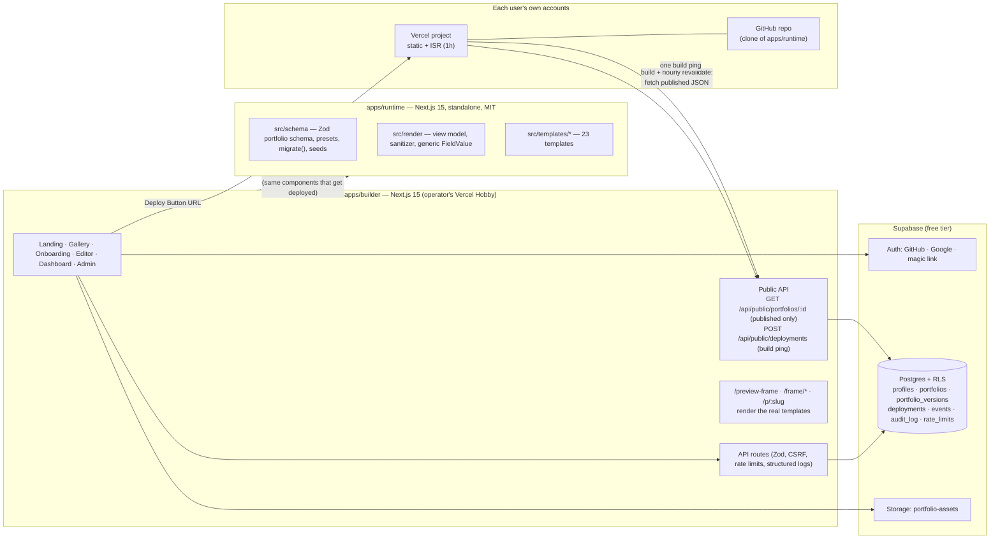

# Persona — portfolio builder with one-click free Vercel deploy

Pick a template → fill a fully dynamic form → watch a live preview → deploy to **your own** Vercel account in one click. Free, open source, no code.

- **23 original templates** — Signal, Editorial, Bento, Aurora, Brutal, Cinematic, Swiss, Desktop OS, Paper, Casefile, Card, Quiet, Kinetic, Archive, Vision, Terra, Lumen, Margin, Thread, Sketchbook, Vivid, Arcade, Executive — each with 3 OKLCH palettes (light + dark, WCAG AA checked in CI) and 3 font pairs.
- **Fully dynamic content** — 15 preset section kinds plus custom sections; add, rename, reorder and remove fields in *any* section; 18 field types. Every template renders every section and field.
- **Users own their site** — it deploys into their Vercel account and GitHub repo; the runtime is MIT licensed and keeps working if the builder is down.
- **$0 to run** — Vercel Hobby + Supabase free tier. No Vercel-only products, so it can move to Cloudflare Workers (OpenNext) with config changes only.
- **First-party analytics + admin dashboard + audit log** — cookie-less, no raw IPs, Do-Not-Track honoured.

## Architecture



**Why the preview is trustworthy:** the schema and the templates live in `apps/runtime`. The builder imports them through the `@runtime/*` tsconfig alias, so the editor's live preview (an iframe at `/preview-frame`, fed by debounced `postMessage`) renders the *exact* components that get deployed.

```
apps/
  builder/        Next.js 15 · React 19 · Tailwind v4 · Radix (shadcn-style) · dnd-kit · RHF + Zod · Tiptap · Recharts
  runtime/        The deployable portfolio site. Builds from its own folder with only its own package.json.
    src/schema/     portfolio.ts (Zod), presets.ts, migrate.ts, factory.ts, seeds/
    src/render/     view.ts (type-driven view model), sanitize.ts, FieldValue.tsx, Root.tsx, color.ts
    src/templates/  meta.ts (palettes, fonts), registry.tsx, base.css, <template>/
    scripts/        prebuild.mjs (snapshot + build ping), check-contrast.ts
supabase/migrations/   SQL: tables, RLS policies, token bucket, storage bucket
e2e/                   Playwright: full user flow, every template × light/dark with axe, builder a11y, admin
docs/lighthouse.md     Lighthouse report (generated by `pnpm lighthouse`)
```

## Local setup

Requires Node 20+ and pnpm 10.

```bash
pnpm install
```

```bash
pnpm dev
```

- Builder: http://localhost:3100 · Runtime: http://localhost:3200
- With **no Supabase env vars set, the builder runs in local mode**: a file-backed store (`apps/builder/.data/`) and a dev sign-in where any email works. Everything — editor, publish, deploy screen, admin (`ADMIN_EMAILS`) — works without external services. Local mode only activates in development, or in a production build when `LOCAL_MODE=1` (used by the e2e suite); it is ignored whenever Supabase is configured.

### Checks

```bash
pnpm lint
```

```bash
pnpm typecheck
```

```bash
pnpm test
```

```bash
pnpm contrast
```

```bash
ENABLE_TEMPLATE_PREVIEW=1 pnpm build
```

```bash
pnpm e2e
```

`pnpm e2e` expects both apps to be built; it starts the builder in local mode and the runtime with its template test bench (`/preview/<template>/<light|dark>`, which only exists when `ENABLE_TEMPLATE_PREVIEW=1`). `pnpm lighthouse` regenerates `docs/lighthouse.md` against the same two servers.

## Environment variables

`apps/builder/.env.example` (copy to `apps/builder/.env.local`):

| Variable | Required | Purpose |
| --- | --- | --- |
| `NEXT_PUBLIC_SUPABASE_URL` | prod | Supabase project URL |
| `NEXT_PUBLIC_SUPABASE_ANON_KEY` | prod | Supabase anon (publishable) key |
| `SUPABASE_SERVICE_ROLE_KEY` | prod | **Server only.** Used for the public API, analytics, audit log, admin |
| `ADMIN_EMAILS` | prod | Comma-separated emails allowed into `/admin` (checked server-side on every request) |
| `ANALYTICS_SALT_SECRET` | prod | Long random string; derives the daily-rotating analytics salt and audit IP hash |
| `NEXT_PUBLIC_SITE_URL` | prod | Public URL of the builder, e.g. `https://persona.example.com` — baked into deploy links as `BUILDER_URL` |
| `RUNTIME_REPO_URL` | prod | Public Git repo containing `apps/runtime`, e.g. `https://github.com/you/portfolio-builder` |
| `RUNTIME_REPO_BRANCH` | optional | Branch to deploy from (default `main`) |
| `LOCAL_MODE` | optional | `1` forces local mode in a production build (e2e). Ignored when Supabase is configured |
| `FEATURE_VERCEL_API_DEPLOY` | optional | Phase-2 scaffold flag (off). See "Deploy flow" |

`apps/runtime/.env.example` — set automatically by the Deploy Button: `PORTFOLIO_ID`, `BUILDER_URL`; optional `NEXT_PUBLIC_SITE_URL` (canonical URL for a custom domain).

## Supabase setup

1. Create a project at supabase.com (free tier).
2. Run the three migrations in `supabase/migrations/` in order — with the CLI (`supabase link`, then `supabase db push`) or by pasting each file into the SQL editor. They create every table with Row Level Security, the `take_token` rate-limit function and the public `portfolio-assets` storage bucket (2 MB, images only, per-user folders).
3. **Authentication → Providers:** enable GitHub and Google (each needs an OAuth app; callback `https://<project>.supabase.co/auth/v1/callback`) and Email (magic link).
4. **Authentication → URL configuration:** set *Site URL* to your builder URL and add `https://<builder>/auth/callback` to *Redirect URLs*.
5. Copy the project URL, anon key and service-role key into the builder's env vars.

Security model: user-facing operations run with the user's session, so **RLS is the source of truth** ("users read and write only their own rows"). `events`, `audit_log` and `rate_limits` have no policies and are revoked from `anon`/`authenticated`: only the server can touch them. The public API returns `published` only. The migrations and policies are executed against an in-process Postgres (PGlite) in `apps/builder/src/lib/sql.test.ts`.

## Deploying the builder

1. Push this repository to GitHub and **make it public** (the Deploy Button clones `apps/runtime` from it; private repos cannot be cloned by your users).
2. Import it into Vercel (Hobby), with **Root Directory = `apps/builder`**. Vercel detects pnpm and Next.js; leave "Include files outside the root directory" enabled (the builder imports `../runtime/src`).
3. Add the environment variables above, including `RUNTIME_REPO_URL` (this repo's URL) and `NEXT_PUBLIC_SITE_URL` (the builder's URL), then redeploy.

## How the deploy flow works

1. **Publish.** The editor has autosaved *drafts* and an explicit *Publish*, which copies the draft to `portfolios.published`. Only the published version is ever served publicly.
2. **Deploy Button.** `/deploy/:id` shows a link built by `apps/builder/src/lib/deploy.ts`:

   ```
   https://vercel.com/new/clone
     ?repository-url=<RUNTIME_REPO_URL>/tree/main/apps/runtime
     &project-name=<slug>-portfolio&repository-name=<slug>-portfolio
     &env=PORTFOLIO_ID,BUILDER_URL
     &envDefaults={"PORTFOLIO_ID":"…","BUILDER_URL":"…"}
     &envDescription=…
   ```

   The user signs in to Vercel, clicks Deploy, and ends up owning a GitHub repo and a Vercel project. Nothing is deployed into the builder's account.
3. **Build.** `scripts/prebuild.mjs` fetches `GET {BUILDER_URL}/api/public/portfolios/{PORTFOLIO_ID}`, writes it to `src/data/fallback.json`, and sends **one** confirmation ping to `POST {BUILDER_URL}/api/public/deployments` with `{ portfolioId, vercelUrl, templateId, runtimeVersion }` (validated, rate-limited, disclosed in `/privacy`). The page is then rendered statically.
4. **Updates.** The page uses ISR (`revalidate = 3600`): edits published in the builder appear within the hour with no redeploy.
5. **Resilience.** If the builder is unreachable at build time, the bundled `fallback.json` is used. If it is unreachable at revalidation time, the fetch throws and Next.js keeps serving the last successfully generated page.
6. **Status screen.** `/deploy/:id` polls until the build ping arrives, then shows the live URL and custom-domain instructions.
7. **Download code (.zip).** The same runtime with the portfolio baked into `src/data/portfolio.json` — builds anywhere with no builder and no env vars.
8. **Phase 2 (scaffold, off).** `FEATURE_VERCEL_API_DEPLOY` + `src/lib/vercel-api.ts` + `/api/deploy/vercel` sketch deployment through Vercel OAuth and `POST /v13/deployments` (no GitHub needed). Token exchange and storage are not implemented.

## The data model

`apps/runtime/src/schema/portfolio.ts` is the single source of truth (Zod → TypeScript types), stored as versioned JSONB.

- `Portfolio = { schemaVersion, meta, profile, theme, sections[] }`
- `Section = { id, kind, title, subtitle?, visible, layout?, fields[], items?, itemSchema? }` — `fields` are single values, `itemSchema` is the user-defined shape of each repeatable `item`.
- `FieldType` = text · longtext · richtext · url · email · phone · number · metric · date · daterange · image · gallery · tags · link · linklist · video · code · select.
- `migrate(portfolio)` upgrades older `schemaVersion`s (and drops unknown field types rather than failing).

**How every template renders every section:** `src/render/view.ts` turns a section into `Entry` objects *purely from field types and order* — the first text is the title, the first date the date, the first image the cover, the first metric the metric; everything else lands in `rest` and is drawn by the generic `<FieldValue>`. Templates lay out `Entry` objects in six layouts (timeline, grid, list, quotes, metrics, tags), so a user-invented "Patents" section with *(title, patent no., link, date)* looks native everywhere. Hidden or empty sections and items are removed in the view model and never reach a template.

## Integrations

People can connect accounts (GitHub, LeetCode, Codeforces, …) so their portfolio shows live, real numbers. The feature is **off by default** (`FEATURE_INTEGRATIONS=1` turns it on) and is being built in stages — see [`docs/integrations/PROGRESS.md`](docs/integrations/PROGRESS.md) for what has landed and the manual ops steps.

What exists in the data model and renderer today (works in all 23 templates, no template code involved):

- **`chart` field type** — `heatmap`, `line`, `bars` or `rings`, drawn once in `apps/runtime/src/render/Chart.tsx` as static inline SVG using theme tokens, with an accessible name and a hidden data table.
- **`sync` on a section** — marks it as fetched from a connected account; the renderer adds one quiet provenance line ("Live from github.com · updated … · Verified owner"). "Verified owner" appears only when ownership was actually checked.
- **`integrations` on the portfolio** — the user's choices per connected account (never tokens, never fetched data).

How it works (`apps/builder/src/lib/integrations/`):

- A **provider** (`providers/<id>.ts`) implements `fetch(account)` and `toSections(data, cfg)`; it maps public data into ordinary sections. Each has recorded-fixture unit tests and never runs in the browser.
- The latest fetch per account is stored in **`integration_snapshots`** (public data only — no tokens, no passwords). Disconnecting deletes it.
- **Merge on read:** `GET /api/public/portfolios/[id]` swaps the content of synced sections for the latest snapshot, keeping the user's position, title and visibility. Snapshots older than 12 hours are served as they are and refreshed after the response; a provider is called automatically at most once per 6 hours per account. Deployed sites therefore update themselves with no cron and no redeploy. A failed refresh keeps the last good data.
- **Zip export** bakes the latest snapshot in, worded "From … as of …" because it stops updating.
- **Editor:** an **Accounts** tab (only when the flag is on) lists providers ("Official API" or "Experimental"), connects a handle with inline validation, lets the user pick where new sections go and switch every metric, chart and entry on or off, verify ownership with a bio code, refresh (once per 10 minutes) and disconnect. Synced sections show a lock in the section list: content is read-only, but they can be renamed, reordered and hidden.
- **Flags:** `FEATURE_INTEGRATIONS=1` enables everything; `INTEGRATION_<PROVIDER>_DISABLED=1` stops calls to one provider. With the flag off, or before the migration is applied, the app behaves exactly as before.

| Provider | API | Shows |
| --- | --- | --- |
| GitHub | Official (GraphQL, server token) | Contribution heatmap, top languages by code (bars), contributions / stars / followers / public repos, pinned repos as projects (optional). Verified by signing in with the same GitHub account, or a bio code. |
| LeetCode | Experimental (unofficial public GraphQL) | Solved easy/medium/hard (rings), submission heatmap, problems solved, contest rating, top percentile, contests, max streak, active days; badges (incl. Knight/Guardian) as awards; most-solved topics as skills. Bio code in About me. |
| Codeforces | Official (public API, no key) | Current and max rating with rank titles, rated contests, rating history (line). Bio code in First name or Organization. |
| Stack Overflow | Official (Stack Exchange API 2.3; `STACKEXCHANGE_KEY` optional) | Reputation, gold/silver/bronze counts, top tags by answer score (bars), gold and silver badges as awards. Bio code in About me. |
| Credly | Experimental (public `badges.json`) | Certifications (name, issuer, issue date) linking to each issuer-backed badge page; HTTPS badge images on request. Labelled "Issuer-verified on Credly"; no ownership check of our own. |
| Writing | Official (DEV API, Hashnode GraphQL, Medium and Substack RSS) | Latest 10 posts with dates and links in a Writing (publications) section; total post count where the platform reports it (DEV, Hashnode). Provenance names the actual platform. |
| npm / PyPI | Official (npm registry + downloads API; PyPI XML-RPC `user_packages`, JSON API, pypistats) | Package count, last-month downloads, weekly downloads trend (line) for the top 5, and a package list with version and monthly downloads. Account `npm/<user>` or `pypi/<user>`. |
| Hugging Face | Official (Hub API) | Counts of models, Spaces and datasets, total likes, model downloads (last 30 days), and the top 4 of each as linked entries. Users and organizations. |
| GitLab | Official (REST v4, gitlab.com, no token) | Public project count and total stars, top 6 projects by stars as project entries. Bio code in the GitLab bio. |
| Achievement wall | No network (aggregator) | One "big numbers" section with each connected provider's own strongest signals (e.g. LeetCode Knight, Codeforces max rating, GitHub stars), each labelled with its source and verification. Verified accounts only unless the user opts in. |

## Adding a template — the template contract

A template is **metadata + one component + one stylesheet**.

1. **Metadata** — add an entry to `TEMPLATES` in `apps/runtime/src/templates/meta.ts`: `id`, `name`, `description`, `signature`, `tags`, `preferredMode`, `layouts`, 3–4 `palettes` and 2–3 `fontPairs`.
   - Palettes are OKLCH triples in the order `ground, surface, ink, mute, line, edge, sig, sigink, comp`, for both `light` and `dark`: 60-30-10 (`ground` / `surface` / `sig`), one signal hue for actions, one complementary accent (`comp`, < 5% of the surface).
2. **Component** — `apps/runtime/src/templates/<id>/index.tsx`, default-exporting `({ portfolio }: TemplateProps)`. Call `viewPortfolio(portfolio)` and wrap everything in `<TemplateRoot portfolio={portfolio}>`.
3. **Styles** — `<id>/<id>.css`, scoped under `[data-template="<id>"]`, imported from `src/templates/index.css`. Use the token utilities (`bg-ground`, `text-ink`, `text-mute`, `border-line`, `bg-sig`, `text-sigink`, `rounded-pf`, `font-display`, …) — never raw colours.
4. **Register** — add the component to `TEMPLATE_COMPONENTS` in `src/templates/registry.tsx`.
5. **Tests** — add the id to `TEMPLATES` in `e2e/templates.spec.ts`.

Checklist (enforced by `pnpm contrast`, the registry unit test and `e2e/templates.spec.ts`):

- [ ] Renders **every** section kind and layout: handle `timeline`, `grid`, `list`, `quotes`, `metrics`, `tags`, plus the section `lead` (single-value fields); end every entry with `<Tail>` so leftover fields are never dropped.
- [ ] Exactly one `<h1>` (the name) even when the hero section is hidden (`hero.present === false`); sections are `<section aria-labelledby>` with an `<h2>`; entries use `<h3>`.
- [ ] `<main id="main" tabIndex={-1}>` (the skip link from `TemplateRoot` targets it); visible focus states; all interactions keyboard-operable.
- [ ] Works from 360px to 2560px with no horizontal overflow, with a real small-screen layout.
- [ ] Light and dark via tokens only; all palettes pass `pnpm contrast`.
- [ ] `motion: "none"` and `prefers-reduced-motion` produce a still page (base CSS handles CSS animation; client islands must check both).
- [ ] No layout shift: images go through `` (fixed aspect box), reveals use transform/opacity.
- [ ] Server components by default. Client code lives in `<id>/islands.tsx`; anything heavy (framer-motion) goes in `<id>/impl.tsx` behind `next/dynamic` so other templates never download it.
- [ ] Only relative imports (the builder compiles these files too, so `@/` aliases are not available) and no server-only APIs.
- [ ] Original design — no cloned layouts, copy or assets.

## Analytics, admin and audit log

- Events go through `/api/track` (`navigator.sendBeacon`, batched) or are written server-side. `session_hash = sha256(daily_salt + ip + user_agent)`, salt rotating every UTC day; raw IPs are never stored; DNT / GPC are honoured.
- `/admin` (emails in `ADMIN_EMAILS`): KPI tiles with sparklines, funnel, visitors and deploys over time, template popularity, custom-section names, referrers, devices, countries, recent deployments and signups, most-edited portfolios, and an audit-log viewer with filters, before/after diff and CSV export. Admin actions are themselves audited.

## Billing seam

Nothing is paid. `apps/builder/src/lib/billing.ts` exposes `getPlan()` / `limitsFor()` (everyone is `free`); limits such as "max portfolios" already flow through it, so a paid plan is a matter of implementing `getPlan`.

## Portability (Cloudflare Workers via OpenNext)

The builder uses no Vercel-only products: persistence is Supabase over HTTPS, hashing is Web Crypto, the zip export is generated from a bundled JSON module (no filesystem access at request time), country comes from `x-vercel-ip-country` **or** `cf-ipcountry`. Local mode (`node:fs`) is development-only.

## Known limitations

- The Supabase code path is type-checked and its SQL/RLS is tested on PGlite, but it has not been exercised against a live Supabase project in this repository's CI (e2e runs in local mode).
- Lighthouse: accessibility, best practices and SEO score 100; performance is 93–98 in a throttled lab run with LCP around 2.2–3.0 s (see `docs/lighthouse.md`), short of the 2.0 s LCP goal on simulated slow 4G.
- Templates that use framer-motion (Bento, Cinematic, Desktop OS) ship ~165 kB of JavaScript on first load; the others ~115–118 kB (the 15 templates added by the template factory use only small client islands, no framer-motion).
- Admin analytics aggregate at most the latest 20,000 events per query.
- Uploaded images referenced by a downloaded zip remain hosted in Supabase Storage.

## License

`apps/runtime` is MIT licensed (see `apps/runtime/LICENSE`). Sites built with it belong to their owners.
